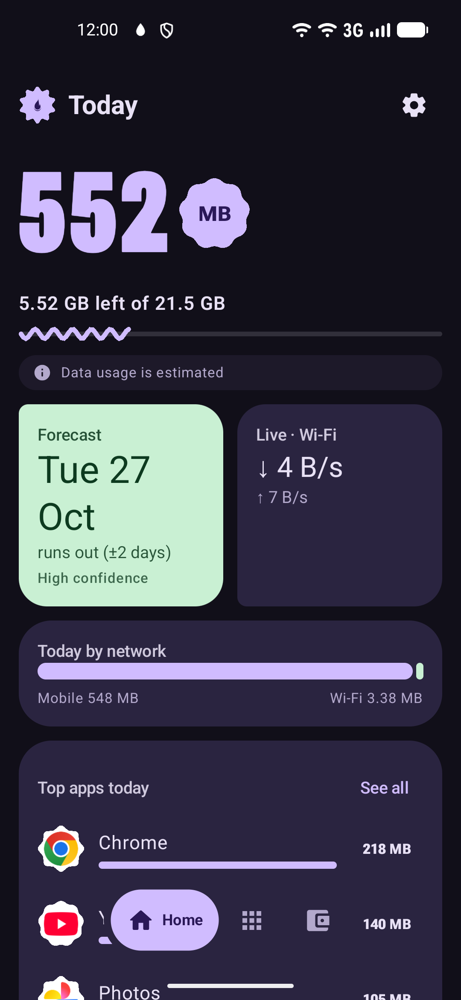
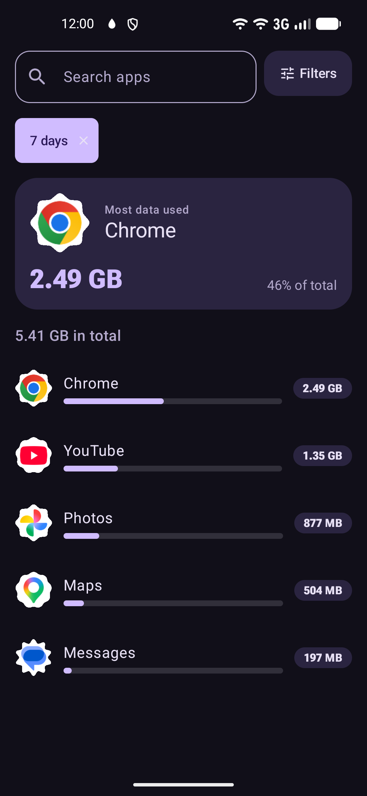
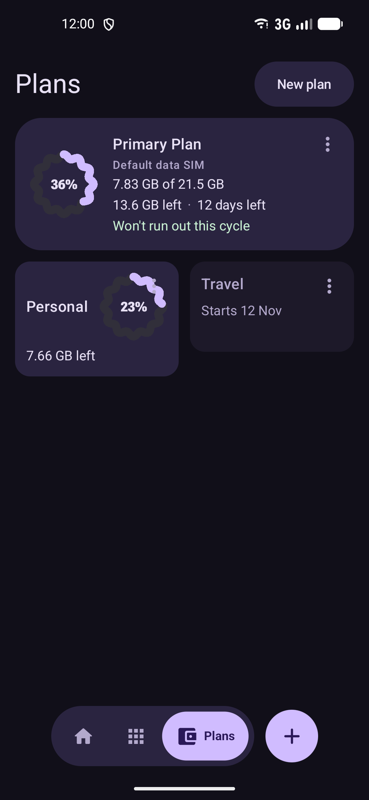
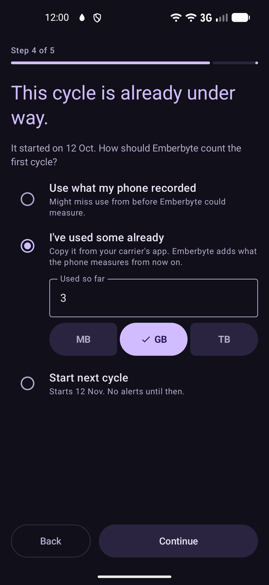
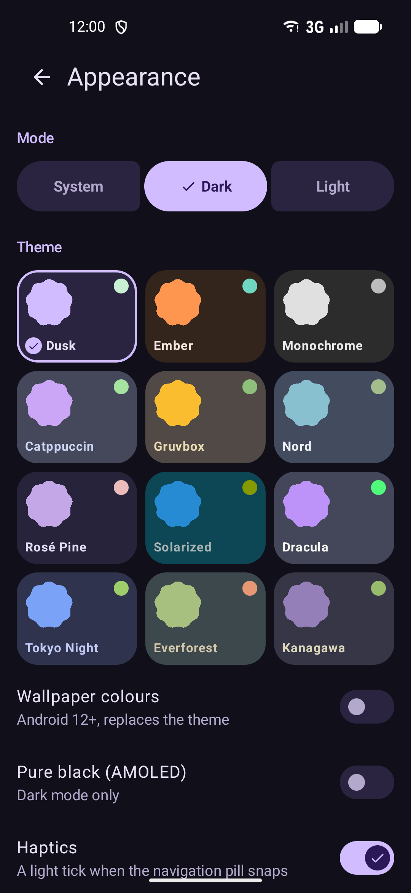
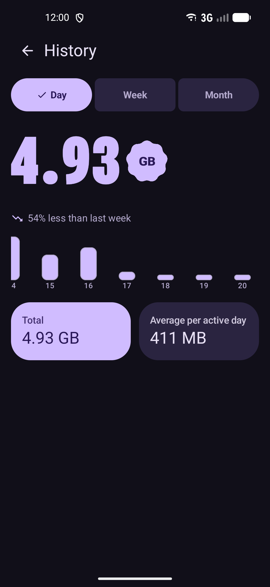
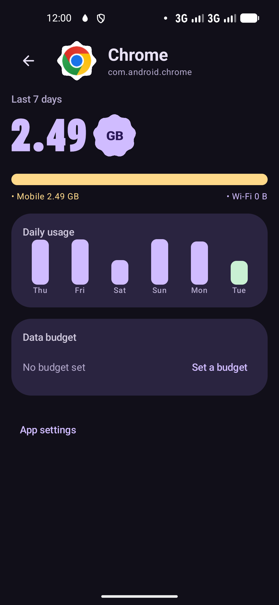

# Emberbyte

An open-source Android data monitor with a Material 3 Expressive interface: real-time transfer speed,
daily and total data consumption by mobile and Wi-Fi, per-app usage history, flexible data plans with
per-SIM binding, add-on packs, free windows, rollover, personalized quota run-out forecasts, threshold
alerts, home-screen widgets, per-app budgets, spike detection, "what if" planning, data export, and
encrypted local backups.

**Website: [emberbyte-site.vercel.app](https://emberbyte-site.vercel.app)** · [Download](https://github.com/Khaledbahaaeldin/Emberbyte/releases/latest) · [Report an issue](https://github.com/Khaledbahaaeldin/Emberbyte/issues/new/choose)

> "DataKB" was the project codename; the repository is now named Emberbyte.

---

## Screenshots

| Home | Apps | Plans | New plan |
|:---:|:---:|:---:|:---:|
|  |  |  |  |

| Themes | History | App detail |
|:---:|:---:|:---:|
|  |  |  |

These are real captures of the 1.0.0 release build (Dusk dark theme, demo data). The same images are used for the F-Droid listing.

---

## Features

- **Live Speed Indicator**: Ongoing foreground notification displaying real-time download speed and remaining plan data.
- **Totals by Mobile & Wi-Fi**: Clear separation of cellular mobile data and Wi-Fi network consumption.
- **Per-App History**: Breakdown of data usage per application across daily and 2-hour measurement windows with real application icons.
- **Flexible Data Plans with Forecast & Alerts**: Custom billing cycles (monthly or every N days), SIM binding, add-on quota packs, free data windows (e.g. night data), and usage rollover (capped or uncapped). Supports mid-cycle plan creation with three start modes: *From phone record*, *Entered usage*, or *Start later*, alongside plan pinning. Predicts run-out dates based on your learned hourly usage curve over the last 28 days and alerts at 50%, 80%, 90%, and 100% quota.
- **Four Home-Screen Widgets**: Jetpack Glance widgets adhering to a strict < 1.5 MiB image budget:
  - **Today (2x2)**: Today's usage as a large number and the plan status.
  - **Plan (2x2)**: Wavy progress ring, remaining data, and days left in the cycle.
  - **Bento (4x2)**: Data consumption, live transfer speed, run-out forecast, and dual-tone network bar.
  - **Dashboard (4x4)**: Comprehensive view with hero consumption, plan progress, 7-day bar chart, top 3 apps, and direct app deep links.
- **Per-App Data Budgets**: Set daily or billing-cycle cellular budgets per application with warning notifications.
- **Spike Detector**: Alerts when an app consumes an unusual surge of mobile data against a 14-day median baseline.
- **"What If" Scenario Planner**: Explore how hypothetical extra daily usage alters your projected run-out date.
- **CSV and JSON Streamed Export**: Stream historical traffic metrics without memory spikes.
- **Encrypted Local Backup & Restore**: Secure `.emberbyte` archive backups of plans, budgets, and hourly usage protected with Argon2id and AES-256-GCM.
- **Predictive Back & Live Updates**: Smooth system predictive back animations across all sub-screens with guarded dirty form protection, and Android 16 live-update promotion with a status-bar chip where the phone maker supports it (it did not show on a Galaxy S24+ with One UI 8.5 in our test; the notification itself always works).

> [!NOTE]
> An in-depth packet inspection feature ("Live Lens") was explored during development and discarded due to CPU and battery constraints; see [ADR 0001: Discard Live Lens](docs/adr/0001-discard-live-lens.md). Emberbyte avoids VPN tunnels entirely.

---

## Themes & Typography

Emberbyte features an expressive design foundation powered by variable **Roboto Flex** typography and **12 hand-tuned themes**: three original palettes (*Dusk*, *Ember*, *Monochrome*) and nine popular community themes (*Catppuccin*, *Gruvbox*, *Nord*, *Rosé Pine*, *Solarized*, *Dracula*, *Tokyo Night*, *Everforest*, and *Kanagawa*). Every theme supports light mode, dark mode, and pure-black AMOLED mode with verified WCAG contrast (at least 4.5:1 text, 7:1 hero numbers, 3:1 marks), alongside dynamic wallpaper-derived Material You theming on supported Android versions.

For architectural design details and instructions on authoring custom palettes, see the [Expressive Redesign Summary](docs/redesign-summary.md).

---

## Privacy Guarantee

Everything stays on your device. Emberbyte operates 100% offline and declares NO `android.permission.INTERNET`. There are no accounts, no telemetry, no tracking, and no external servers. All metrics and configuration are stored locally in Room databases and encrypted archives.

---

## Declared Permissions

Every permission declared in [`AndroidManifest.xml`](app/src/main/AndroidManifest.xml) is required for core local features and documented in [RELEASE.md](docs/release/RELEASE.md):

| Permission | Type | Justification / Usage |
|---|---|---|
| `android.permission.PACKAGE_USAGE_STATS` | Special App Access | Required to query per-application daily and hourly data usage buckets via `NetworkStatsManager`. Granted explicitly by user in Android Settings > Usage Access. |
| `android.permission.QUERY_ALL_PACKAGES` | System / Store Policy | Required to resolve installed app names, icons, and package visibility across UIDs for data usage breakdown on Android 11+ (API 30+). |
| `android.permission.ACCESS_NETWORK_STATE` | Normal | Required to observe active network connectivity (Wi-Fi vs Cellular vs Metered) and network capabilities. |
| `android.permission.READ_PHONE_STATE` | Dangerous / Runtime | Required on multi-SIM devices to detect active subscription IDs and correlate cellular usage with the user's configured data plan SIM slot. |
| `android.permission.POST_NOTIFICATIONS` | Runtime (API 33+) | Required to post plan alerts (thresholds chosen per plan from 50%, 80%, 90% and 100%; default 80% and 100%), budget and spike alerts, and the ongoing live notification. |
| `android.permission.POST_PROMOTED_NOTIFICATIONS` | Normal (API 36+) | Required for Android 16+ Promoted Ongoing live status bar indicator showing today's total, the amount left near the cap, or "Over". |
| `android.permission.FOREGROUND_SERVICE` | Normal | Required to run `SamplerService` as a background foreground service for periodic network rate sampling and threshold checks. |
| `android.permission.FOREGROUND_SERVICE_SPECIAL_USE` | Foreground Service Type (API 34+) | Declares the specific foreground service subtype (`data_metering_sampler`) for continuous background network traffic monitoring under modern platform restrictions. |
| `android.permission.RECEIVE_BOOT_COMPLETED` | Normal | Allows `BootReceiver` to start `SamplerService` after a reboot or an app update (only once onboarding is complete), so measuring continues without opening the app. |
| `android.permission.WAKE_LOCK` | Normal | Merged by AndroidX WorkManager runtime to allow background periodic maintenance and catch-up jobs to acquire wake locks during execution. |
| `io.github.khaledbahaaeldin.emberbyte.DYNAMIC_RECEIVER_NOT_EXPORTED_PERMISSION` | Signature | Merged by AndroidX Core library to protect internal dynamic broadcast receivers from unauthorized external broadcasts on modern Android versions. |

---

## Known Limitations

- New traffic can take up to about 5 minutes to appear in Today (O-1).
- "Measurement paused" only appears after the system or a vendor kills the service, and force-stopping Emberbyte stops measuring until it is opened again (N-10).
- Spikes are judged on whole 2-hour windows (Android keeps per-app history in 2-hour buckets), so a spike is noticed within one catch-up cycle after the window has enough traffic, not within minutes.
- Budgets and spikes count mobile data only.
- A backup cannot be recovered without its passphrase (there is no reset).
- Restoring replaces plans, budgets and history on this device and skips usage rows of apps that are not installed.
- Per-SIM history is estimated when more than one SIM was used (backend spec section 5).
- A plan bound to a SIM is marked "Estimated" when part of its history has no SIM information (pre-install or backfilled traffic) or the window starts before Emberbyte's first measurement (for example without usage access).
- Plan alerts need the app notification setting AND the 'Plan alerts' channel enabled.
- A VPN running over Wi-Fi is counted twice.

---

## Installation

- **GitHub Releases (available)**: download `emberbyte-<version>.apk` and its `.sha256` from the [Releases](https://github.com/Khaledbahaaeldin/Emberbyte/releases) page. The APK is built and signed by this repository's release workflow. Verify it (replace `<version>`, for example `1.0.1`):
  ```bash
  sha256sum -c emberbyte-<version>.apk.sha256
  apksigner verify --print-certs emberbyte-<version>.apk
  ```
  The certificate SHA-256 must be `72ad25a3d8366a07339c7b239be0dfd70d427cfb7dfe498b92621e4c604595ef`. Requires Android 10 or newer.
- **Obtainium (installs and updates straight from GitHub Releases)**: [add Emberbyte to Obtainium](https://apps.obtainium.imranr.dev/redirect?r=obtainium://app/%7B%22id%22%3A%22io.github.khaledbahaaeldin.emberbyte%22%2C%22url%22%3A%22https%3A%2F%2Fgithub.com%2FKhaledbahaaeldin%2FEmberbyte%22%2C%22author%22%3A%22Khaledbahaaeldin%22%2C%22name%22%3A%22Emberbyte%22%7D), or in Obtainium choose "Add App" and paste `https://github.com/Khaledbahaaeldin/Emberbyte`.
- **F-Droid**: submitted and in review ([merge request](https://gitlab.com/fdroid/fdroiddata/-/merge_requests/53562)). F-Droid signs its own build, so its APK has a different signature from the GitHub one; do not mix the two sources on one phone. See the [recipe](docs/release/fdroiddata-io.github.khaledbahaaeldin.emberbyte.yml).

---

## Build

### Requirements
- JDK 17 (Eclipse Temurin recommended)
- Android SDK Platform API 37 (compileSdk 37, targeting Android 16 / API 36)
- Android Build Tools `36.1.0` (or newer)

### Build Commands
```bash
# Debug build
./gradlew assembleDebug

# Run unit tests
./gradlew testDebugUnitTest :core:engine:test

# Release APK build (deterministic & reproducible)
./gradlew :app:assembleRelease --no-build-cache --no-daemon
```

---

## Contributing

Contributions, bug reports, and suggestions are welcome!
1. Fork the repository and create a feature branch.
2. Ensure strict code formatting and run the verification test suite before opening a pull request:
   ```bash
   ./gradlew testDebugUnitTest :core:engine:test lintDebug assembleDebug
   ```
3. Explain why changes are needed in commit messages.

---

## Credits

See [CONTRIBUTORS.md](CONTRIBUTORS.md) for who built what, and [NOTICE](NOTICE) for third-party material (theme palettes, Roboto Flex and libraries).

---

## Licence

Emberbyte is free software, licensed under the **GNU General Public License, version 3 or (at your option) any later version** (SPDX: `GPL-3.0-or-later`).
See [LICENSE](LICENSE) for the full licence text and [NOTICE](NOTICE) for third-party software credits.
